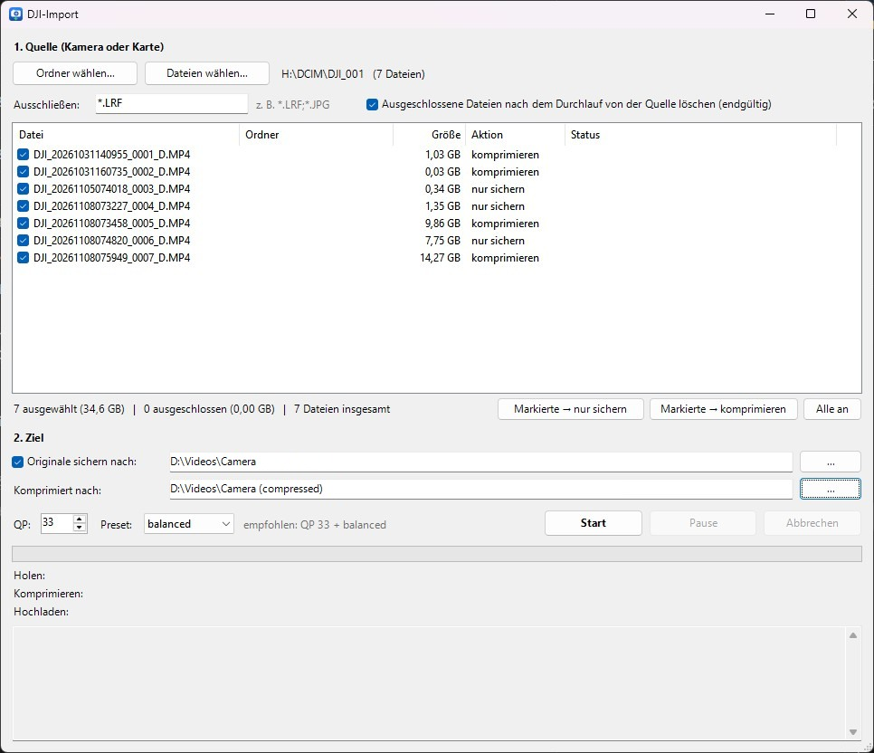

<div align="center">


# CamOffload

**Offload, back up and GPU-compress camera footage in one pass.**

[](#requirements)
[](#requirements)
[](#encoding-pipeline)
[](https://ffmpeg.org/)
[](LICENSE)

[Features](#features) •
[Quick start](#quick-start) •
[Benchmarks](#benchmarks) •
[Configuration](#configuration) •
[FAQ](#faq)

</div>

---

CamOffload is a lightweight Windows front end around FFmpeg for action-cam footage. Select clips straight
from the camera or its card, and it copies, encodes and writes them **concurrently** – the original goes
untouched to the backup location you choose (internal drive, external disk or network share), and a
verified HEVC copy that is typically **25–35 % smaller** goes next to it.

No installer, no runtime, no dependencies beyond FFmpeg: two PowerShell scripts and an optional
30 KB launcher.

> [!NOTE]
> The UI is currently German only. Setting this up with a coding agent? Point it at [AGENTS.md](AGENTS.md).

<details>
<summary><b>Screenshot</b></summary>
<br>



</details>

## Features

|  |  |
|---|---|
| **Three-stage pipeline** | Read from the camera, encode on the GPU and write to the destination, all overlapping. |
| **Per-file actions** | `komprimieren` (back up + compress) or `nur sichern` (back up only, e.g. for Gyroflow). |
| **Pattern exclusion** | `*.LRF;*.JPG` style filters, with optional deletion from the card after a complete run. |
| **Pause & resume** | Pause after the current clip, cancel instantly, resume later – finished files are skipped. |
| **Verified output** | Frame count must match and the result must be smaller, otherwise the original is kept. |
| **Smart passthrough** | Low-bitrate (< 50 Mbit/s) and already edited clips are copied 1:1. |
| **Metadata preserved** | Container metadata and file timestamps carry over. |

## Quick start

```powershell
git clone https://github.com/allmightychaos/CamOffload.git
cd CamOffload
powershell -NoProfile -STA -ExecutionPolicy Bypass -File CamOffload.ps1
```

Prefer a double-clickable app with an icon? Build the launcher – the C# compiler ships with Windows:

```powershell
& "$env:WINDIR\Microsoft.NET\Framework64\v4.0.30319\csc.exe" /nologo /target:winexe `
  /win32icon:CamOffload.ico /r:System.Windows.Forms.dll /out:CamOffload.exe build\Launcher.cs
```


## Requirements

| Component | Minimum | Notes |
|---|---|---|
| OS | Windows 10 / 11 | Windows PowerShell 5.1 (preinstalled) |
| GPU | AMD Radeon with AMF HEVC encoder | ~0.6 GB VRAM per 4K60 encode |
| FFmpeg | `ffmpeg` + `ffprobe` on `PATH`, with `hevc_amf` | e.g. [gyan.dev](https://www.gyan.dev/ffmpeg/builds/) full build |

## Encoding pipeline

```text
ffmpeg -hwaccel d3d11va -i IN.MP4 -map 0:v:0 -map 0:a:0? \
  -c:v hevc_amf -quality balanced -rc cqp -qp_i 33 -qp_p 33 -bf 0 -g <fps> \
  -profile:v main10 -pix_fmt p010le -tag:v hvc1 \
  -c:a copy -map_metadata 0 -movflags +faststart OUT.mp4
```

<details>
<summary><b>Why each flag is there</b></summary>
<br>

| Flag | Rationale |
|---|---|
| `-hwaccel d3d11va`, no `-hwaccel_output_format` | A full-GPU path with B-frames produced corrupted frames. |
| `-bf 0` | Same issue – B-frames disabled. |
| `-rc cqp -qp_i 33 -qp_p 33` | Constant quality; AMF HEVC rejects `-rc qvbr` (init error 10). |
| `-quality balanced` | 1.6–1.8× faster than `quality` at ~0.5–1 VMAF cost. |
| `-g <fps>` | 1 keyframe/s so outputs stay losslessly cuttable (+1.9 % size). |
| `main10` / `p010le` | Keeps the camera's 10-bit signal. |
| `-tag:v hvc1` | Apple playback compatibility. |

</details>

## Benchmarks

4K 60 fps cycling footage, VMAF computed on every frame against the original.

### Rate–quality trade-off

Hardest clip in the set (heavy motion, 96 s, 1.24 GB):

| Setting | Size | Ratio | VMAF avg | VMAF 1 % low | Throughput |
|---|---:|---:|---:|---:|---:|
| QP 32 · `quality` | 0.84 GB | 68 % | 95.2 | – | ~61 fps |
| QP 32 · `balanced` | 0.87 GB | 70 % | 94.3 | 77.0 | ~95–110 fps |
| **QP 33 · `balanced`** (default) | **0.77 GB** | **62 %** | **92.3** | – | **~95–110 fps** |
| QP 34 · `balanced` | 0.68 GB | 54 % | 89.8 | 70.3 | ~95–110 fps |

**QP 33 · `balanced`** is the default: it keeps the worst-case clip above VMAF 90 while running at
almost twice real-time. Each QP step trades ~11 % size; `balanced` vs. `quality` changes speed, not size.

### Real-world savings

| Workload | Clips | Input | Output | Saved |
|---|---:|---:|---:|---:|
| QP 32 · `quality` | 17 | 33.45 GB | 25.78 GB | −23 % |
| QP 33 · `balanced` | 5 | 26.85 GB | 19.69 GB | −27 % |
| QP 33 · `balanced`, projected | 287 | ~706 GB | ~480 GB | ~−32 % |

Savings vary wildly with content – from 1.03 GB → 0.05 GB on a static scene to 14.27 GB → 10.10 GB on
dense foliage and gravel.

<details>
<summary><b>Test system</b></summary>
<br>

| | |
|---|---|
| GPU | AMD Radeon RX 9060 XT, 16 GB, Adrenalin 26.10.1 (32.0.32015.7029) |
| CPU / RAM | Intel Core i5-14600KF · 32 GB |
| Storage | Samsung 970 NVMe (scratch) · network share via SMB (destination) |
| OS | Windows 11 Home, build 26200 |
| FFmpeg | 8.0.1 full build (gyan.dev) |

Throughput is bound by the GPU's fixed-function video engine (VCN): parallel encodes do not scale, and
Task Manager shows ~60–80 % *Video Encode* load at ~40–50 W. That is expected, not a misconfiguration.

</details>

## Configuration

Defaults live at the top of `CamOffload.ps1`; the last used values are saved to `einstellungen.json`.

| Setting | Default | Where |
|---|---|---|
| Backup destination | `$BatchSrc` | top of `CamOffload.ps1` |
| Compressed destination | `$BatchDst` (auto-derived from backup path) | top of `CamOffload.ps1` |
| Exclusion pattern | `*.LRF` | GUI |
| QP / preset | `33` / `balanced` | GUI |
| Passthrough threshold | `50` Mbit/s | `MinMbps` in `CamOffload.ps1` |

## FAQ

<details>
<summary><b>Why not AV1?</b></summary>
<br>
In testing, <code>av1_amf</code> produced at most ~5 % smaller files and many older devices cannot play
AV1. HEVC is the better trade-off here.
</details>

<details>
<summary><b>Does it keep the gyro data for Gyroflow?</b></summary>
<br>
Not in the compressed file – FFmpeg cannot mux DJI's telemetry tracks into MP4. Mark those clips
<code>nur sichern</code> and stabilise from the original; Gyroflow's export then is your compressed file.
</details>

<details>
<summary><b>Can I use an NVIDIA or Intel GPU?</b></summary>
<br>
Not out of the box. Swap the <code>hevc_amf</code> call in <code>worker.ps1</code> for
<code>hevc_nvenc</code> or <code>hevc_qsv</code> and re-tune QP – the numbers above are AMF-specific.
</details>

<details>
<summary><b>Is anything on the camera modified?</b></summary>
<br>
No. The source is read-only, unless you explicitly enable deletion of excluded files – and even then
only after a complete run and a confirmation prompt.
</details>

## Limitations

- **Compression is currently tuned for DJI originals.** Only files whose encoder tag identifies them as
  DJI camera originals are re-encoded; footage from other cameras is backed up and copied 1:1. Automatic
  source detection also looks for DJI volume labels – other cameras can be selected manually.
- AMD GPUs only (`hevc_amf`); see the FAQ for NVIDIA / Intel.
- German UI.
- Default destinations and the state file of a separate batch script are hard-coded at the top of
  `CamOffload.ps1`.

## Project layout

```text
CamOffload/
├── CamOffload.ps1      # WinForms GUI
├── worker.ps1          # copy → encode → upload pipeline
├── CamOffload.ico
├── build/
│   ├── Launcher.cs     # console-less .exe launcher
│   └── make_icon.ps1   # regenerates the icon
├── docs/               # screenshot, icon
└── AGENTS.md           # setup guide for coding agents
```

## Contributing

Issues and pull requests are welcome. Please keep `.ps1` files **UTF-8 with BOM** (required for
umlauts in PowerShell 5.1) and include before/after VMAF numbers for any encoder change.

## Acknowledgements

Built on the shoulders of
[FFmpeg](https://ffmpeg.org/) ·
[gyan.dev builds](https://www.gyan.dev/ffmpeg/builds/) ·
[AMD AMF](https://github.com/GPUOpen-LibrariesAndSDKs/AMF) ·
[Netflix VMAF](https://github.com/Netflix/vmaf) ·
[LosslessCut](https://github.com/mifi/lossless-cut) ·
[Gyroflow](https://gyroflow.xyz/)

## License

Released under the [MIT License](LICENSE).

<div align="center">
<sub>Not affiliated with DJI or AMD.</sub>
</div>
